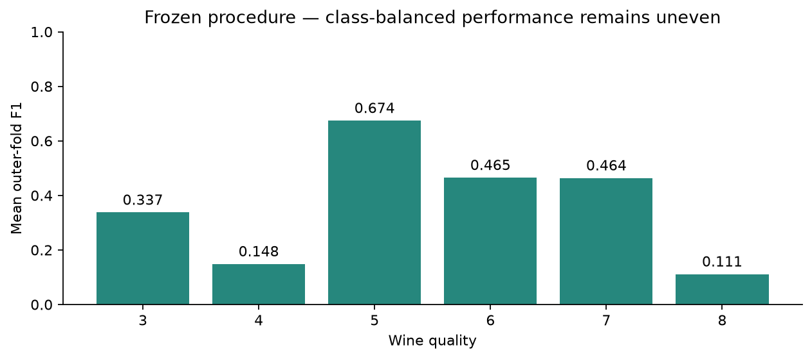

# Wine Quality Classification

## Overview

This project analyzes red-wine measurements to predict six ordered quality grades. It investigates classification methods, class imbalance, and the difficulty of recognizing rare grades.

The final Version 2 report uses a saved model and evaluation evidence. It demonstrates how validation design and per-class results affect the interpretation of model performance.

## Project Objective

The objective is to classify wine quality from eleven physicochemical measurements while giving each quality grade equal weight in evaluation. The study emphasizes macro F1, rare-class performance, and the separation of model development from holdout testing.

## Skills Demonstrated

- Data Cleaning and Duplicate Handling
- Exploratory Data Analysis (EDA)
- Multiclass Classification
- Class Imbalance and Resampling
- Nested Cross-Validation
- Per-Class Evaluation and Model Interpretation

## Tools and Technologies

- Python 3.14
- pandas and NumPy
- scikit-learn and imbalanced-learn
- Matplotlib
- JupyterLab, nbclient, and joblib

## Dataset

The source is the red-wine component of [UCI Wine Quality](https://archive.ics.uci.edu/dataset/186/wine+quality), by Cortez et al. (2009), DOI 10.24432/C56S3T. UCI lists the dataset under CC BY 4.0.

The source contains 1,599 records. The recorded cleaning removed 240 exact duplicates, leaving 1,359 observations: 1,087 development wines and 272 original holdout wines. The eleven measurements predict integer quality grades 3 through 8.

The source CSV is excluded. The `data/` directory retains [download and conversion instructions](data/README.md), split/hash metadata, and two handwritten unlabeled examples. UCI’s semicolon-delimited file must be converted to the documented comma-delimited format.

## Key Analysis Performed

### Data Cleaning and Exploration

Reviewed duplicates, class frequencies, measurement distributions, and feature correlations. Rare grades contain very few genuine examples.

### Validation Design

Used development-only nested validation with four outer folds repeated ten times and three inner folds. Scaling and sampling stay within the appropriate training folds.

### Class Imbalance and Model Comparison

Compared classification and ordinal/regression approaches. The selected procedure uses LDA with StandardScaler, gentle capped SMOTE, and protected Tomek cleaning.

### Per-Class Evaluation

Reported macro F1, balanced accuracy, ordinal metrics, confusion patterns, and class-specific precision and recall.

### Model Packaging

Retained the fitted scaler and LDA for inference, with metadata and integrity checks. The report can be reviewed without loading the source dataset.

## Results

| Metric | Version 2 development CV result |
| --- | ---: |
| Macro F1 | 0.366587 |
| Macro F1 fold SD | 0.054874 |
| Balanced accuracy | 0.391318 |
| Quadratic weighted kappa | 0.527035 |
| Accuracy | 0.539736 |
| MAE in quality points | 0.535891 |
| Within one quality grade | 0.930539 |

The macro F1 objective of 0.50 was not achieved. Quality-4 and quality-8 mean-fold F1 were 0.148437 and 0.111171. There is **no new independent Version 2 holdout result**. The 10,870 repeated OOF predictions represent 1,087 unique wines, not 10,870 independent samples. See the [final summary](tables/final_version2_model_summary.csv).

## Example Visualizations

The final report includes class distributions, feature summaries, correlations, repeated OOF confusion counts, per-class F1, and fitted LDA coefficients. Current report figures are in `visuals/submission/`.



## Installation

Clone the repository and create an environment using Python 3.14:

```bash
git clone https://github.com/staticbloom/wine-quality-classification.git
cd wine-quality-classification
python3.14 -m venv .venv
```

Activate the environment on macOS/Linux:

```bash
source .venv/bin/activate
```

On Windows, create the environment with `py -3.14 -m venv .venv` and activate it in PowerShell:

```powershell
.venv\Scripts\Activate.ps1
```

Install the recorded dependencies:

```bash
python -m pip install -r requirements.txt
python -m pip check
```

The version pins match the recorded project environment. Installation in a fresh environment has not been independently verified.

## Usage

### Score the handwritten examples

```bash
python predict.py data/example_wines.csv --output outputs/wine_predictions.csv
```

The V2 model is included. The examples have no known labels and demonstrate the input schema, not predictive accuracy. Use a new output filename.

### Open the report

```bash
python -m jupyterlab notebook/Wine-Quality-Classification.ipynb
```

The active report reads retained evidence without fitting models or parsing the raw CSV. Keep its supporting tables, model, and visual directories.

Optional guarded verification:

```bash
python verify_notebook_replay.py --cwd root
```

This requires local Jupyter kernel sockets and refreshes generated execution records and manifest entries. Add `--write` only when intentionally updating saved notebook outputs.

### Train or evaluate a separate candidate

```bash
python train.py new_labeled_wines.csv --output-dir runs/wine_candidate
python train.py new_labeled_wines.csv --evaluate-only --output-dir runs/wine_evaluation
```

Supply the eleven features plus `quality`. The separate fixed-recipe trainer uses an 80/20 split, requires at least five real examples of every class, and does not recreate the historical nested search. Output directories must be new.

## Limitations and Reproducibility

- The old holdout was consumed by Version 1 and must not be reused to select Version 2.
- Rare classes remain difficult; repeated exploration of development data can make selected estimates optimistic.
- Synthetic observations do not increase independent sample size. Batch identifiers and external validation are unavailable.
- The historical development archive is incomplete. Some legacy pickles require an absent package and are excluded. Use the supported V2 artifact.

See [technical notes](TECHNICAL_NOTES.md) for the complete input contract, detailed workflow, and reproduction limits. Model artifacts should only be loaded from trusted sources.

## Author

**Shiv Sharma**

Data Analyst working with Python, statistical analysis, data visualization, and machine learning.
